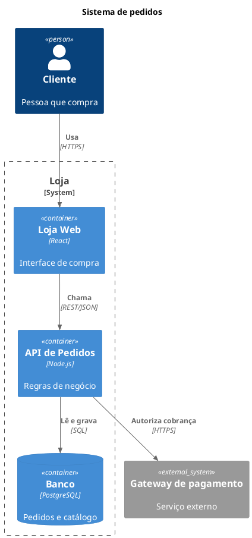

# PlantUML

Skill para criar e manter diagramas como código com PlantUML. Fonte:
<https://plantuml.com/>.

## Quando usar

- Escrever ou revisar um diagrama `.puml` (UML, C4, sequência, classes,
  atividades, estados, implantação, casos de uso, timing, Gantt, mindmap).
- Escolher o tipo de diagrama adequado para comunicar uma decisão.
- Modelar arquitetura C4 com a biblioteca C4-PlantUML.
- Definir tema, cores, legendas e estilo de forma consistente.
- Usar preprocessamento (`!include`, variáveis, procedures, `!theme`).
- Renderizar, validar e versionar diagramas no CI.
- Importar ou exportar PlantUML no C4Arch.

## Princípios

1. **Diagrama como código.** O `.puml` é a fonte da verdade, versionado junto
   do código; a imagem é artefato gerado.
2. **Um arquivo, um diagrama.** Cada bloco começa em `@startuml` e termina em
   `@enduml`; nomeie o arquivo pelo propósito (`contexto-pedidos.puml`).
3. **Aliases estáveis.** Use `alias` curtos, sem espaços e sem acentos
   (`api`, `banco`, `cliente`). Rótulos mudam; aliases são contrato das
   relações e da importação.
4. **Biblioteca em vez de cópia.** Para C4 use `!include <C4/C4_Container>` (ou
   superior) e macros oficiais; não redefina `Person`, `Container` ou `Rel`.
5. **Estilo centralizado.** Tema em uma diretiva `!theme`; ajustes finos em
   `UpdateElementStyle` (C4) ou `<style>` (UML). Evite `skinparam` em código
   novo: está depreciado em favor de CSS style.
6. **Legibilidade primeiro.** Poucos elementos por diagrama, relações com
   verbo, tecnologia explícita, legenda quando houver cores ou tags.
7. **Validar antes de publicar.** Renderize localmente/CI com `-checkonly` e
   falhe o build em erro de sintaxe.
8. **Determinismo.** Evite URLs remotas quando o ambiente for offline; prefira
   stdlib empacotada ou um caminho `plantuml.include.path` versionado.

## Estrutura mínima


- `@startuml` pode receber um nome (`@startuml contexto-pedidos`), útil para
  referência e inclusão por id.
- Comentários: `'` no início da linha; bloco `/' ... '/`.
- `title`, `caption`, `header`, `footer` e `legend`/`endlegend` documentam o
  diagrama sem poluir o desenho.
- `scale 1.5` ou `scale 1024 width` ajusta o tamanho final.
- `left to right direction` / `top to bottom direction` orientam o layout
  global.

## Escolha do diagrama

| Objetivo | Tipo | Página oficial |
| --- | --- | --- |
| Arquitetura C4 (contexto, container, componente, implantação, dinâmico) | C4-PlantUML | `/stdlib` (seção C4) |
| Interação entre atores e serviços ao longo do tempo | Sequência | `/sequence-diagram` |
| Estrutura estática de tipos e relações | Classes | `/class-diagram` |
| Fluxo de trabalho, decisões e paralelismo | Atividade (beta) | `/activity-diagram-beta` |
| Ciclo de vida de uma entidade | Estados | `/state-diagram` |
| Escopo e atores do sistema | Casos de uso | `/use-case-diagram` |
| Distribuição em nós e artefatos | Implantação | `/deployment-diagram` |
| Estrutura de componentes e interfaces | Componentes | `/component-diagram` |
| Instantâneo de objetos e valores | Objetos | `/object-diagram` |
| Sinais elétricos/digitais no tempo | Timing | `/timing-diagram` |
| Cronograma de projeto | Gantt | `/gantt-diagram` |
| Hierarquia de ideias | MindMap / WBS | `/mindmap-diagram`, `/wbs-diagram` |
| Protótipo de tela | Salt | `/salt` |
| Estrutura de dados | JSON / YAML | `/json`, `/yaml` |
| Modelo empresarial | ArchiMate | `/archimate-diagram` |

Detalhes de sintaxe por tipo: `references/diagramas.md`.

## C4-PlantUML em 30 segundos



Regras práticas:

- Inclua apenas o arquivo C4 de nível mais alto que o diagrama precisa:
  `C4_Context` → `C4_Container` → `C4_Component`; `C4_Deployment` para nós.
- `Person`/`System` recebem descrição no 3º argumento; `Container`/`Component`
  recebem **tecnologia** no 3º e descrição no 4º.
- `System_Boundary` e `Container_Boundary` agrupam elementos, não são
  elementos C4.
- Relações: `Rel(origem, destino, "verbo", "tecnologia")`; use `BiRel` para
  bidirecional e `Rel_Back` para inverter a seta sem mudar a ordem.
- Layout: `LAYOUT_TOP_DOWN()`, `LAYOUT_LEFT_RIGHT()`,
  `LAYOUT_AS_SKETCH()`; legenda com `LAYOUT_WITH_LEGEND()` ou
  `SHOW_LEGEND()`.

Detalhes, assinaturas e estilos: `references/c4-plantuml.md`.

## Estilo e preprocessamento

```plantuml
@startuml
!theme spacelab
!$cor = "#1168BD"
<style>
rectangle {
  BackgroundColor $cor
  FontColor White
  LineColor #0B4F8A
}
</style>
@enduml
```

- `!theme <nome>` aplica um tema oficial (lista com `help themes`).
- `<style>` é a forma atual de estilizar; aceita seletores por tipo de
  elemento e por estereótipo.
- `skinparam` ainda funciona, mas está depreciado; use só para compatibilidade.
- Preprocessamento: `!$var = valor`, `!if/!else/!endif`, `!procedure`,
  `!function`, `!include`, `!import`, `!foreach`.
- `!pragma layout smetana` melhora layout de componentes; `!pragma teoz true`
  habilita recursos avançados de sequência.

Referência completa: `references/estilo-e-preprocessamento.md`.

## Validação e renderização

```console
java -jar plantuml.jar -checkonly diagrama.puml
java -jar plantuml.jar -tsvg diagrama.puml
java -jar plantuml.jar -tpng -o out diagrama.puml
java -jar plantuml.jar -charset UTF-8 -Dplantuml.include.path=./puml diagrama.puml
```

- `-checkonly` valida sintaxe sem gerar imagem (bom para CI).
- `-tsvg` gera vetor; `-tpng` para bitmap; `-ttxt` para depuração.
- Em pipeline, renderize com `-failfast2` para falhar no primeiro erro.
- Servidor local: `java -jar plantuml.jar -picoweb` (porta 8080) ou a imagem
  `plantuml/plantuml-server`.

## Integração com o C4Arch

- Templates prontos: `GET /api/models/import/plantuml/templates`.
- Criar modelo a partir de PlantUML: `POST /api/models/import/plantuml`.
- Reaplicar/substituir em modelo existente:
  `POST /api/models/{id}/import/plantuml`.
- Exportar o modelo como C4-PlantUML: formato `plantuml` em
  `/api/models/{id}/export/plantuml` (`.puml`).
- O importador lê um subconjunto de C4-PlantUML (elementos, relações, título,
  `$tags`, tecnologia, fronteiras/blocos aninhados e tipo de visão). Ele **não**
  preserva sprites, links/URLs nem `AddElementTag`. Fronteiras não têm tipo
  próprio: viram o elemento estrutural do nível para manter a hierarquia.
- Ao gerar conteúdo para o C4Arch, use aliases estáveis, macros suportadas e
  `!include <C4/...>`; evite construções que o parser não entende. A exportação
  reusa o `identifier` canônico como alias, então exportar → editar → aplicar
  mantém os mesmos identificadores.

Detalhes de contrato, limitações e exemplos: `references/integracao-c4arch.md`.

## Erros comuns

- Esquecer `@startuml`/`@enduml` ou deixar texto fora do bloco.
- Usar espaço, hífen ou acento em alias (`Servico de Pedidos`) e depois
  referenciá-lo de outra forma.
- Passar descrição no lugar de tecnologia em `Container`/`Component`.
- Incluir `C4_Component` e `C4_Container` juntos sem necessidade.
- Redeclarar macros C4 ou definir `Person` como `actor` manualmente.
- Deixar `skinparam` novo em vez de `<style>`/`!theme`.
- Depender de `!include` remoto em build offline.
- Colocar `!theme` depois de elementos: aplique antes de declarar o conteúdo.
- Quebrar os argumentos de uma macro em várias linhas: o preprocessador exige
  a chamada inteira em uma linha.
- Usar `autonumber` em diagrama que não é de sequência.
- Esperar que o C4Arch importe hierarquia de boundaries: hoje ela é achatada.

## Referências

- `references/c4-plantuml.md` — macros, boundaries, relações, layout, tags e
  estilos da biblioteca C4-PlantUML.
- `references/diagramas.md` — sintaxe essencial de cada tipo de diagrama.
- `references/estilo-e-preprocessamento.md` — temas, `<style>`, `skinparam`,
  variáveis, procedures, includes e CLI.
- `references/integracao-c4arch.md` — endpoints, templates, parser, limites e
  fluxo de importação/exportação no C4Arch.

Documentação oficial: <https://plantuml.com/>. Biblioteca C4-PlantUML:
<https://github.com/plantuml-stdlib/C4-PlantUML>.
