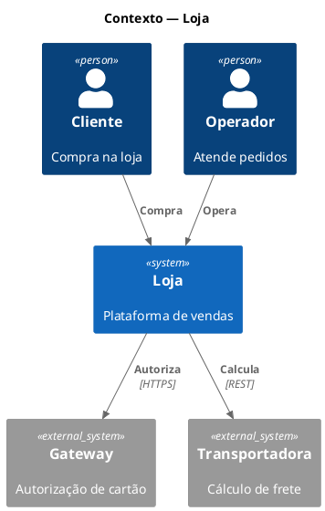
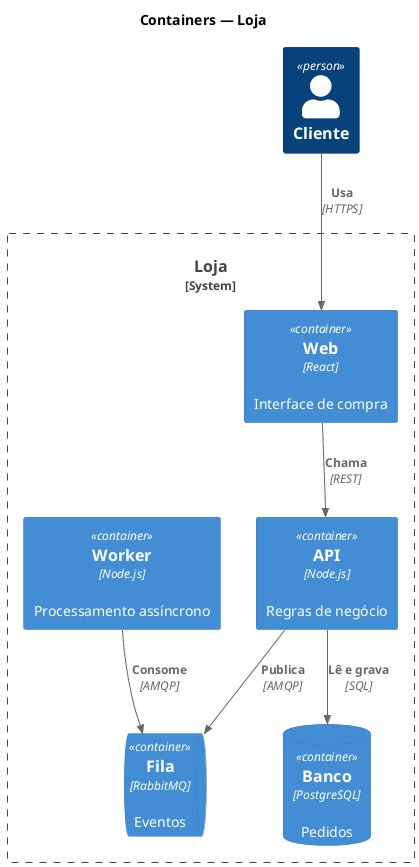
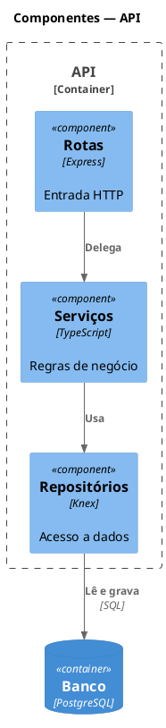
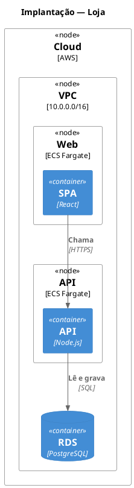
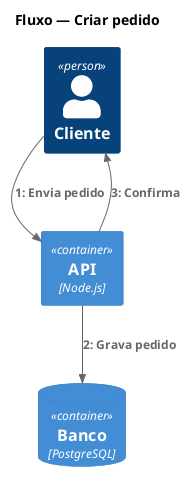
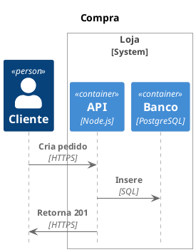

# C4-PlantUML

Referência da biblioteca oficial **C4-PlantUML**, usada para desenhar os
diagramas C4 do Simon Brown como código. Fontes:

- Standard Library: <https://plantuml.com/stdlib> (seção C4)
- Repositório: <https://github.com/plantuml-stdlib/C4-PlantUML>
- C4 model: <https://c4model.com/diagrams>

## Inclusão

```plantuml
@startuml
!include <C4/C4_Container>
' ...
@enduml
```

| Include | Disponibiliza | Inclui também |
| --- | --- | --- |
| `<C4/C4_Context>` | `Person`, `System`, boundaries de empresa/sistema | — |
| `<C4/C4_Container>` | containers (`Container`, `ContainerDb`, `ContainerQueue`) e `Container_Boundary` | Context |
| `<C4/C4_Component>` | componentes (`Component`, `ComponentDb`, `ComponentQueue`) | Container |
| `<C4/C4_Deployment>` | `Deployment_Node`, `Node`, `Node_L`, `Node_R` | Context/Container |
| `<C4/C4_Dynamic>` | relações numeradas (`$index`) | Component |
| `<C4/C4_Sequence>` | participantes e mensagens em diagrama de sequência | — |

Regras:

- Inclua **um** arquivo, o de nível mais alto que o diagrama usa. Incluir
  `C4_Component` já traz container e contexto; não repita os outros.
- O include sem extensão resolve pela stdlib empacotada. Para fixar versão ou
  usar sem stdlib:

```plantuml
!include https://raw.githubusercontent.com/plantuml-stdlib/C4-PlantUML/v2.15.0/C4_Container.puml
```

- Em ambiente offline, baixe os `.puml` e use `-Dplantuml.include.path=./c4` ou
  a variável `RELATIVE_INCLUDE` (a própria biblioteca troca o include remoto
  por `./C4_*.puml` quando ela existe).

## Elementos

Assinaturas: argumentos com `?` são opcionais. `$alias` é o identificador usado
nas relações; `$label` é o texto exibido.

### Contexto (`C4_Context`)

| Macro | Assinatura | Uso |
| --- | --- | --- |
| `Person` | `(alias, label, ?descr, ?sprite, ?tags, ?link, ?type)` | pessoa que usa o sistema |
| `Person_Ext` | idem | pessoa externa à organização |
| `System` | `(alias, label, ?descr, ?sprite, ?tags, ?link, ?type)` | software system em escopo |
| `System_Ext` | idem | sistema externo |
| `SystemDb` | idem | sistema com forma de banco |
| `SystemDb_Ext` | idem | banco externo |
| `SystemQueue` | idem | sistema com forma de fila |
| `SystemQueue_Ext` | idem | fila externa |
| `Enterprise_Boundary` | `(alias, label, ?tags, ?link, ?descr)` | fronteira da empresa |
| `System_Boundary` | `(alias, label, ?tags, ?link, ?descr)` | fronteira do sistema |

### Containers (`C4_Container`)

| Macro | Assinatura | Uso |
| --- | --- | --- |
| `Container` | `(alias, label, ?techn, ?descr, ?sprite, ?tags, ?link)` | aplicação/serviço |
| `Container_Ext` | idem | container externo |
| `ContainerDb` | idem | banco de dados |
| `ContainerDb_Ext` | idem | banco externo |
| `ContainerQueue` | idem | fila/broker |
| `ContainerQueue_Ext` | idem | fila externa |
| `Container_Boundary` | `(alias, label, ?tags, ?link, ?descr)` | agrupa componentes de um container |

### Componentes (`C4_Component`)

| Macro | Assinatura | Uso |
| --- | --- | --- |
| `Component` | `(alias, label, ?techn, ?descr, ?sprite, ?tags, ?link)` | componente |
| `Component_Ext` | idem | componente externo |
| `ComponentDb` | idem | componente com forma de banco |
| `ComponentDb_Ext` | idem | banco externo |
| `ComponentQueue` | idem | componente com forma de fila |
| `ComponentQueue_Ext` | idem | fila externa |

> **Cuidado com a posição dos argumentos.** Em `Person`/`System` o 3º argumento
> é **descrição**; em `Container`/`Component` o 3º é **tecnologia** e o 4º é
> **descrição**. Trocar isso gera diagramas com texto no lugar errado.

### Implantação (`C4_Deployment`)

| Macro | Assinatura | Uso |
| --- | --- | --- |
| `Deployment_Node` | `(alias, label, ?type, ?descr, ?sprite, ?tags, ?link)` | nó de infraestrutura |
| `Node` | idem | alias de `Deployment_Node` |
| `Node_L` | idem | nó à esquerda |
| `Node_R` | idem | nó à direita |

Dentro de um nó cabem `Container`, `ContainerDb`, `Component` e outros nós.

## Boundaries

```plantuml
System_Boundary(loja, "Loja") {
  Container(web, "Web", "React")
  Container(api, "API", "Node.js")
  ContainerDb(banco, "Banco", "PostgreSQL")
}
```

- `Enterprise_Boundary` → `System_Boundary` → `Container_Boundary` expressam
  níveis crescentes de detalhe.
- A boundary só agrupa; não vira elemento C4 nem aparece nas relações.
- Em `C4_Deployment`, use `Deployment_Node` no lugar de boundary para nós.
- Não aninhe um `System_Boundary` dentro de outro do mesmo sistema; use
  `Container_Boundary` para o nível interno.

## Relações

| Macro | Efeito |
| --- | --- |
| `Rel(a, b, "label", "tech")` | seta de `a` para `b` |
| `BiRel(a, b, "label", "tech")` | seta nos dois sentidos |
| `Rel_Back(a, b, "label", "tech")` | seta de `b` para `a` (ordem de declaração mantida) |
| `Rel_Neighbor` / `Rel_Back_Neighbor` / `BiRel_Neighbor` | força vizinhança |
| `Rel_U`/`Rel_Up`, `Rel_D`/`Rel_Down`, `Rel_L`/`Rel_Left`, `Rel_R`/`Rel_Right` | direção explícita |
| `BiRel_U`/`_D`/`_L`/`_R` | bidirecional em direção explícita |

Assinatura completa:

```text
Rel(from, to, label, ?techn, ?descr, ?sprite, ?tags, ?link, ?index)
```

- Use **verbo** no label (`"Lê e grava"`, `"Publica eventos"`) e **tecnologia**
  no 4º argumento (`"HTTPS"`, `"SQL"`, `"AMQP"`).
- `descrição` (5º) detalha o contrato sem poluir o rótulo.
- `$index` numera a interação em diagramas dinâmicos.

## Diagrama de contexto



## Diagrama de containers



## Diagrama de componentes



## Diagrama de implantação



## Diagrama dinâmico

O índice numera a ordem das interações. A forma atual é `$index` em `Rel`:



> `RelIndex(...)` ainda existe, mas a própria biblioteca o marca como
> **outdated**; prefira `Rel(..., $index=n)`.

## Diagrama de sequência C4



> Em `C4_Sequence` a boundary é aberta com `System_Boundary(...)` **sem `{`** e
> fechada com `Boundary_End()`. Nos demais diagramas C4, use `{ ... }`.

## Layout e legenda

Aplique os macros **antes** dos elementos:

```plantuml
LAYOUT_TOP_DOWN()
' LAYOUT_LEFT_RIGHT()
' LAYOUT_LANDSCAPE()
' LAYOUT_AS_SKETCH()
LAYOUT_WITH_LEGEND()
```

- `LAYOUT_TOP_DOWN()` é o padrão e favorece leitura hierárquica.
- `LAYOUT_LEFT_RIGHT()` ajuda em fluxos lineares; `LAYOUT_LANDSCAPE()`
  rotaciona o resultado.
- `LAYOUT_AS_SKETCH()` ativa o estilo “rascunho” (útil para discussão).
- `SHOW_LEGEND($hideStereotype="true", $details=Small())` controla a legenda;
  `SHOW_FLOATING_LEGEND()` evita reservar uma coluna; `HIDE_STEREOTYPE()`
  remove os estereótipos visíveis.
- `UpdateLayoutConfig($c4ShapeInRow="4", $c4BoundaryInRow="1")` ajusta a
  quantidade de formas por linha.

## Estilo e tags

```plantuml
@startuml
!include <C4/C4_Container>

UpdateElementStyle("person", $bgColor="#08427B", $fontColor="#FFFFFF")
UpdateElementStyle("container", $bgColor="#438DD5", $fontColor="#FFFFFF")
UpdateRelStyle("#FFFFFF", "#666666")

AddElementTag("externo", $bgColor="#999999", $fontColor="#FFFFFF", $borderColor="#8A8A8A", $legendText="Sistema externo")
AddRelTag("async", $textColor="#FFFFFF", $lineColor="#666666", $lineStyle="dashed", $legendText="Assíncrono")

Container(api, "API", "Node.js")
System_Ext(erp, "ERP", "Sistema legado", $tags="externo")
Rel(api, erp, "Sincroniza", "HTTPS", $tags="async")
@enduml
```



> Macros C4 (`AddElementTag`, `AddRelTag`, `UpdateElementStyle`, ...) precisam
> ficar **em uma única linha**: o preprocessador não aceita argumentos
> quebrados entre linhas.

Macros de estilo:

| Macro | Para que serve |
| --- | --- |
| `UpdateElementStyle(tipo, bg, font, border, shadowing, shape, sprite, techn, legendText, legendSprite, borderStyle, borderThickness)` | muda o estilo base de um tipo C4 |
| `UpdateRelStyle(textColor, lineColor)` | muda texto e linha das relações padrão |
| `UpdateBoundaryStyle(...)` | estilo de boundaries |
| `UpdateContainerBoundaryStyle(...)` | atalho para boundary de container |
| `UpdateSystemBoundaryStyle(...)` | atalho para boundary de sistema |
| `AddElementTag(tag, bg, font, border, shadowing, shape, sprite, techn, legendText, ...)` | cria uma tag de elemento |
| `AddRelTag(tag, textColor, lineColor, lineStyle, sprite, techn, legendText, ...)` | cria uma tag de relação |
| `AddPersonTag` / `AddSystemTag` / `AddContainerTag` | atalhos por tipo |

- Tags são combinadas com `+`: `$tags="externo+legado"`.
- Cores C4 padrão: person `#08427B`, system `#1168BD`, external system
  `#999999`, container `#438DD5`, external container `#B3B3B3`, componente
  `#85BBF0`.
- Use `SHOW_LEGEND()` sempre que criar tags; sem legenda as cores não
  comunicam.
- `NEW_C4_STYLE=1` (antes do include) adota o estilo novo; `ROUNDED_STYLE=1`
  usa cantos arredondados. Só ative se o time inteiro adotar.

## Sprites e links

- `Person(..., $sprite="person")` usa o sprite embutido; há `person2`,
  `robot`, `robot2`. `SHOW_PERSON_SPRITE()`, `SHOW_PERSON_PORTRAIT()` e
  `SHOW_PERSON_OUTLINE()` alternam a representação.
- `$link` aceita URL e cria hyperlink: `Person(u, "Usuário", $link="https://...")`.
- No C4Arch, sprites e links **não são importados**.

## Erros comuns

- Passar tecnologia em `System` (o 3º argumento é descrição).
- Esquecer de fechar `{` de uma boundary — o erro aponta a linha seguinte.
- Misturar `C4_Context` e `C4_Component`: o segundo já inclui o primeiro.
- Aplicar `!theme`/`LAYOUT_*` depois dos elementos.
- Quebrar os argumentos de uma macro C4 em várias linhas: o preprocessador
  (e o importador do C4Arch) exige a chamada inteira em uma linha.
- Usar `System_Boundary(...) { ... }` em `C4_Sequence`; ali a boundary termina
  com `Boundary_End()`.
- Definir `$tags` mas não chamar `SHOW_LEGEND()`.
- Usar `Rel(..., $index=1)` sem `C4_Dynamic`.
- Importar um diagrama com boundaries e esperar hierarquia no C4Arch: o
  importador achata os elementos.
- Depender da URL `master` em produção: fixe uma versão (`v2.15.0`).
