# Sintaxe por tipo de diagrama

Referência rápida dos diagramas mais usados. Cada seção assume o bloco
`@startuml` / `@enduml` em volta. Páginas oficiais na seção de referências.

## Sequência

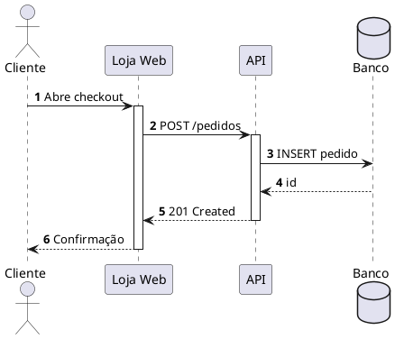

| Recurso | Sintaxe |
| --- | --- |
| Participantes | `actor`, `participant`, `boundary`, `control`, `entity`, `database`, `collections`, `queue` |
| Declaração com alias | `participant "Nome longo" as A` |
| Seta sólida | `A -> B : mensagem` |
| Seta tracejada | `A --> B : resposta` |
| Seta fina | `A ->> B : mensagem` |
| Perda/entrada | `A ->x B`, `A o-> B`, `A ->o B` |
| Ativar/desativar | `activate A`, `deactivate A`, atalhos `A -> B ++ : msg`, `A -> B -- : msg` |
| Criar/destruir | `create B`, `destroy B` |
| Grupo | `alt sucesso ... else erro ... end` |
| Opcional | `opt ... end` |
| Repetição | `loop 1..n ... end` |
| Paralelo | `par ... else ... end` |
| Exceção | `break ... end` |
| Crítico | `critical ... end` |
| Agrupamento livre | `group Rótulo ... end` |
| Caixa de participantes | `box "Frontend" ... end box` |
| Nota | `note right of A : texto` ou `note over A, B ... end note` |
| Referência | `ref over A, B : caso de uso` |
| Divisor | `== Fase 1 ==`, `-- Fase 2 --` |
| Atraso | `...` ou `|||` |
| Autonumeração | `autonumber`, `autonumber 10 10`, `autonumber stop` |

Boas práticas:

- Use `autonumber` quando a ordem das mensagens for o ponto principal.
- Nomeie participantes com o papel (`API`, `Banco`), não com a tecnologia.
- Evite mais de ~15 mensagens por diagrama; divida por cenário.
- `activate`/`deactivate` mostram o tempo de vida; não abuse de caixas.

## Classes

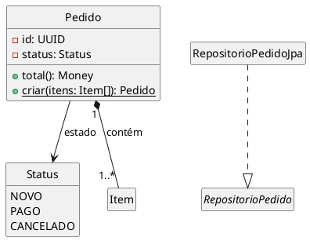

| Recurso | Sintaxe |
| --- | --- |
| Classe | `class Nome`, `class "Nome longo" as Alias` |
| Membro | `+publico`, `-privado`, `#protegido`, `~pacote` |
| Bloco | `class A { +campo: Tipo \n +metodo() }` |
| Modificador | `{static}`, `{abstract}` |
| Tipos | `class Lista<T>` |
| Interface/abstrata | `interface`, `abstract class`, `abstract` |
| Enum/registro | `enum`, `record`, `annotation`, `struct` |
| Herança | `Base <|-- Filha` |
| Implementação | `Interface <|.. Classe` ou `Classe ..|> Interface` |
| Composição | `Todo *-- Parte` |
| Agregação | `Todo o-- Parte` |
| Associação | `A --> B : label` |
| Dependência | `A ..> B : usa` |
| Multiplicidade | `A "1" -- "0..*" B` |
| Pacote | `package "dominio" { ... }`, `namespace` |
| Nota | `note right of A : texto` |
| Ocultar | `hide circle`, `hide empty members`, `hide stereotype` |

## Atividade

O diagrama de atividade atual é o **beta** (`/activity-diagram-beta`), com
`start`/`stop`. A sintaxe antiga (`(*)` e `-->`) ainda existe, mas não é
recomendada para código novo.

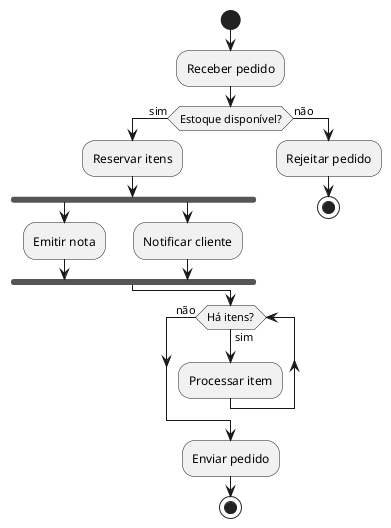

| Recurso | Sintaxe |
| --- | --- |
| Início/fim | `start`, `stop`, `end`, `kill`, `detach` |
| Ação | `:texto;` (aceita `\n`, `**negrito**`, `//itálico//`) |
| Decisão | `if (cond) then (sim) ... else (não) ... endif` |
| Decisão múltipla | `elseif (outra) then (sim)` |
| Repetição | `while (cond) is (sim) ... endwhile (não)` |
| Repetir-até | `repeat ... repeat while (cond) is (sim)` |
| Paralelo | `fork ... fork again ... end fork` |
| Divisão | `split ... split again ... end split` |
| Partição | `partition "Vendas" { ... }` |
| Raia | `|Vendas|` troca a raia corrente; `:ação|` |
| Cor | `#FFAA00:ação;` |
| Estereótipo | `:ação; <<serviço>>` |
| Nota | `floating note right: texto`, `note right ... end note` |
| Direção | `-right->`, `-left->` entre ações |

## Estados

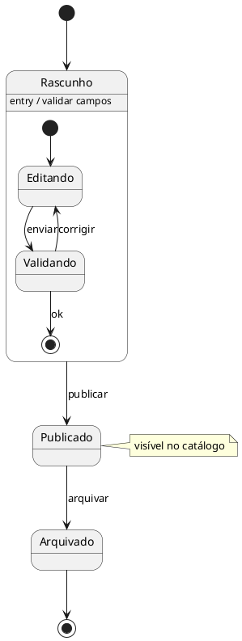

| Recurso | Sintaxe |
| --- | --- |
| Estado inicial/final | `[*] --> Estado`, `Estado --> [*]` |
| Transição | `A --> B : evento [guarda] / ação` |
| Estado composto | `state A { ... }` |
| Nome longo | `state "Em análise" as Analise` |
| Escolha | `state Decisao <<choice>>` |
| Fork/join | `state F <<fork>>`, `state J <<join>>` |
| Entrada/saída | `state P <<entryPoint>>`, `state S <<exitPoint>>` |
| Descrição interna | `A : entry / ação`, `A : do / ação`, `A : exit / ação` |
| Histórico | `[H]`, `[H*]` |
| Concorrência | separe regiões com `--` |
| Nota | `note left of A : texto` |

## Casos de uso

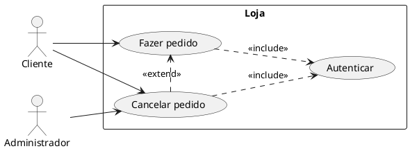

- Atores: `actor Nome`, `:Nome:`.
- Casos: `usecase "Nome" as Alias`, `(Nome)`.
- Fronteira: `rectangle "Sistema" { ... }`, `package`.
- `include` é obrigatório; `extend` é opcional — a seta aponta para o caso
  estendido.

## Componentes

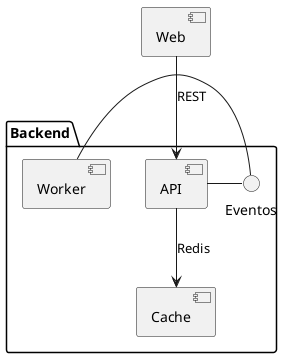

| Recurso | Sintaxe |
| --- | --- |
| Componente | `[Nome]`, `component Nome`, `component "Nome" as Alias` |
| Interface | `() "Nome"`, `interface "Nome" as Alias` |
| Porta | `port`, `portin`, `portout` |
| Agrupamento | `package`, `folder`, `frame`, `cloud`, `node`, `database`, `queue`, `rectangle` |
| Dependência | `[A] ..> [B] : usa` |
| Conector | `[A] - [B]`, `[A] -- [B]` |
| Nota | `note right of api : texto` |
| Layout | `left to right direction`, `top to bottom direction` |

## Implantação

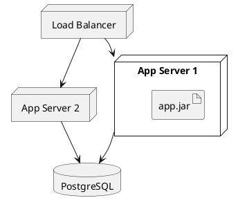

- Elementos: `node`, `artifact`, `file`, `database`, `cloud`, `folder`,
  `frame`, `storage`, `queue`, `component`.
- Aninhamento: `node Nome { ... }`; use `node "Nome" as alias`.
- Descrição longa: `node nome [texto com **markdown**]`.
- Estilos inline: `node n #palegreen;line:green;line.dashed;text:green`.
- Setas: `-->`, `--`, `..>`, `--*`, `--o`, `--+`, `--#`, `-->>`.

## Objetos

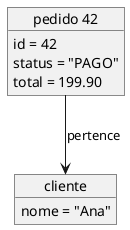

## Timing

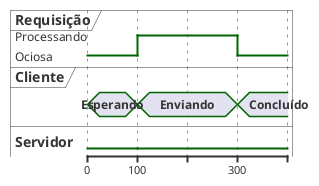

- `robust`, `concise`, `clock`, `binary` declaram as linhas.
- `@0`, `@100`, `@+50` posicionam no tempo; `is` define o estado.
- `clock` alterna automaticamente (`clock "Relógio" as c with period 50`) e
  **não** aceita `is`; para ligado/desligado use `binary`.
- `highlight 100 to 200 : cor`, `constraint`, `timescale 1 month`.

## Gantt

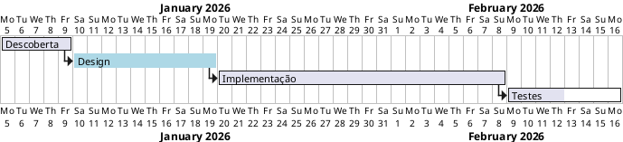

- Tarefas usam `[Nome]` (não aliases).
- `starts at [X]'s end`, `ends at`, `happens at`, `lasts N days`.
- `closed` no início esconde dias não úteis; `separator` cria marcos.

## MindMap e WBS

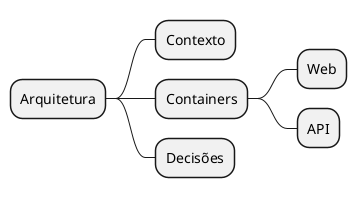

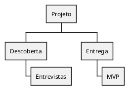

- `*` é a raiz; `**`, `***` aprofundam.
- Em mindmap, `+` cria ramo à direita e `-` à esquerda; `_:texto;` aceita
  múltiplas linhas.

## JSON, YAML e Salt

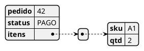

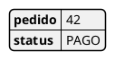

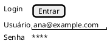

- JSON/YAML: útil para contrato de API; `#highlight "caminho"` realça um nó.
- Salt: protótipo de tela; `{/ Aba }` cria abas, `[Botão]`, `(Radio)`,
  `[X]` checkbox, `^Campo^`.

## Outros

- **ArchiMate** (`/archimate-diagram`): `!include <archimate/Archimate>` e
  macros por camada (`Business_*`, `Application_*`, `Technology_*`).
- **Rede** (`/nwdiag`): blocos `network`, `group`, `server`.
- **Regex** (`/regex`): `@startregex` para autômatos.
- **Wireframe** (`/salt`): ver acima.

## Referências oficiais

- <https://plantuml.com/sequence-diagram>
- <https://plantuml.com/class-diagram>
- <https://plantuml.com/activity-diagram-beta>
- <https://plantuml.com/state-diagram>
- <https://plantuml.com/use-case-diagram>
- <https://plantuml.com/component-diagram>
- <https://plantuml.com/deployment-diagram>
- <https://plantuml.com/object-diagram>
- <https://plantuml.com/timing-diagram>
- <https://plantuml.com/gantt-diagram>
- <https://plantuml.com/mindmap-diagram>
- <https://plantuml.com/wbs-diagram>
- <https://plantuml.com/json>
- <https://plantuml.com/yaml>
- <https://plantuml.com/salt>
- <https://plantuml.com/archimate-diagram>
- <https://plantuml.com/nwdiag>
- <https://plantuml.com/regex>
- <https://plantuml.com/commons>
