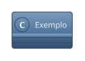

# Estilo, temas e preprocessamento

Fontes oficiais:

- Temas: <https://plantuml.com/theme>
- Style (CSS): <https://plantuml.com/style>
- Skinparam (depreciado): <https://plantuml.com/skinparam>
- Preprocessamento: <https://plantuml.com/preprocessing>
- Commons: <https://plantuml.com/commons>

## Temas



- `!theme <nome>` aplica um tema oficial empacotado; não precisa instalar nada.
- `help themes` lista os temas disponíveis; `%get_all_theme()` devolve um JSON
  com todos (a partir de 1.2024.4).
- Tema local: arquivo `puml-theme-<nome>.puml`:

```plantuml
!theme minha-marca from ./temas
```

- Tema remoto: `!theme amiga from https://.../themes`.
- Alguns temas definem procedures auxiliares:

```plantuml
!theme spacelab
Bob -> Alice : ok
Bob <- Alice : $success("deu certo")
Bob -x Alice : $failure("falhou")
Bob ->> Alice : $warning("atenção")
```

## `<style>` (forma recomendada)



```plantuml
@startuml
<style>
classDiagram {
  BackgroundColor White
  LineColor #333333
  FontColor #111111
  LineThickness 1
}
class {
  BackgroundColor #EEF4FF
  RoundCorner 12
}
.entity {
  BackgroundColor #FFF4D6
  LineColor #B8860B
}
</style>

class Pedido <<entity>>
@enduml
```

- O seletor pode ser o tipo de diagrama (`classDiagram`, `componentDiagram`,
  `sequenceDiagram`), o tipo de elemento (`class`, `component`, `actor`,
  `database`, `rectangle`) ou um estereótipo (`.entity` para `<<entity>>`).
- Propriedades comuns: `BackgroundColor`, `FontColor`, `LineColor`,
  `LineThickness`, `BorderThickness`, `RoundCorner`, `Shadowing`, `Padding`,
  `Margin`, `FontName`, `FontSize`, `FontStyle`, `HorizontalAlignment`.
- Estilo por estereótipo vence o estilo por tipo; o mais específico ganha.
- `<style>` convive com `!theme`: o tema define a base, o bloco sobrescreve.

## `skinparam` (legado)

O site oficial marca `skinparam` como **depreciado**, mantido por
compatibilidade. Em código novo, prefira `<style>`.

```plantuml
skinparam backgroundColor #EEEBDC
skinparam shadowing false
skinparam monochrome true
skinparam defaultFontName "Helvetica"
skinparam defaultFontSize 12

skinparam class {
  BackgroundColor PaleGreen
  ArrowColor SeaGreen
  BorderColor SpringGreen
}
```

- Formas aninhadas (`skinparam class { ... }`) e planas são equivalentes.
- `skinparam monochrome true` força preto e branco; `reverse` inverte.
- `skinparam handwritten true` ativa o estilo manuscrito.
- Para C4, use `UpdateElementStyle`/`UpdateRelStyle` em vez de `skinparam`.

## Cores, fontes e markup

- Cores: nome (`red`, `LightBlue`), hexadecimal (`#FF8800`), `transparent`.
- Gradiente: `#red-yellow` (linear).
- Fonte: `FontName "Inter"` (depende da fonte instalada no servidor);
  `Helvetica`/`Courier` são mais portáveis.
- Markup Creole dentro de rótulos:
  - `**negrito**`, `//itálico//`, `__sublinhado__`, `--tachado--`,
    `""monoespaçado""`
  - `<color:#FF0000>texto</color>`
  - `<size:14>texto</size>`, `<b>`, `<i>`, `<u>`
  - `<back:#FFFFCC>texto</back>`
  - `\n` quebra linha; `\\` escapa barra.
  - `[[https://exemplo]]` e `[[https://exemplo|Rótulo]]` criam links.
- Em rótulos entre aspas, escape `"` com `\"`.

Estilo inline em elementos:

```plantuml
node n #palegreen;line:green;line.dashed;text:#004400
```

Estilo inline em setas:

```plantuml
A --> B : normal
A --> B #red;line.bold;text:red : destaque
A --> B #blue;line.dashed : tracejada
```

## Preprocessamento

O preprocessador é comum a todos os diagramas e usa `!` (como o `#` do C).

### Variáveis

```plantuml
!$porta = 8080
!$nome = "API"
!$cfg = { "timeout": 30 }
!$porta ?= 9090          ' só define se ainda não existir

Alice -> Bob : $nome na porta $porta
Alice -> Bob : timeout $cfg.timeout
```

- Nomes de variável começam com `$`.
- Tipos: inteiro, string (aspas simples ou duplas) e JSON.
- `!global` torna a variável visível em funções; `!local` cria variante local.

### Condicionais e laços

```plantuml
!$env = "prod"
!if ($env == "prod")
  Alice -> Bob : modo produção
!elseif ($env == "dev")
  Alice -> Bob : modo desenvolvimento
!else
  Alice -> Bob : modo desconhecido
!endif

!while ($i < 3)
  Alice -> Bob : $i
  !$i = $i + 1
!endwhile
```

Operadores: `==`, `!=`, `<`, `>`, `<=`, `>=`, `&&`, `||`, `()`. Não há tipo
booleano: `0` é falso; qualquer outro número/string é verdadeiro. Funções:
`%true()`, `%false()`, `%not()`, `%boolval()`.

### Procedures e funções

```plantuml
!procedure $aviso($texto)
  note over Alice, Bob : $texto
!endprocedure

!function $dobro($n)
  !return $n * 2
!endfunction

$aviso("olá")
Alice -> Bob : $dobro(21)
```

- `!procedure` emite comandos; `!function` retorna valor e não emite nada.
- Argumentos e nomes começam com `$`; aceitam valor padrão
  (`$passo=1`) e argumentos nomeados (`$size=10`).
- `!unquoted procedure Nome(...)` permite chamar sem aspas nos argumentos.
- `%invoke_procedure("$nome", ...)` e `%call_user_func("$nome", ...)`
  chamam dinamicamente.

### Includes

```plantuml
!include <C4/C4_Container>            ' stdlib
!include ./comum/estilos.puml         ' arquivo local
!include https://exemplo/estilos.puml ' URL
```

- `!include` inclui uma vez por padrão; `!include_many` permite repetir;
  `!include_once` falha se repetir.
- Subseções: `!startsub NOME` / `!endsub` no arquivo, e
  `!includesub arquivo!NOME` para incluir só o trecho.
- Blocos: `!include arquivo!1` inclui o segundo bloco `@startuml`/`@enduml`;
  `!include arquivo!ID` usa `@startuml(id=ID)`.
- Biblioteca empacotada: `!import lib.zip` adiciona o arquivo ao search path.
- Caminho de busca: `-Dplantuml.include.path="/caminho"` (antes de `-jar`).

### Iteração, log e assert

```plantuml
!$lista = %splitstr("a,b,c", ",")
!foreach $item in $lista
  Alice -> Bob : $item
!endfor

!log valor de $item
!assert %strlen("abc") == 3 : "tamanho inesperado"
```

`!log` e `!dump_memory` não afetam o desenho; `!assert` falha o build quando a
expressão é falsa.

### Funções embutidas úteis

| Função | Retorno |
| --- | --- |
| `%date("yyyy-MM-dd")` | data atual formatada |
| `%now()` | epoch em segundos |
| `%strlen(s)` | tamanho |
| `%substr(s, pos, len)` | substring |
| `%strpos(s, sub)` | posição |
| `%upper(s)` / `%lower(s)` | caixa |
| `%intval(s)` / `%string(v)` | conversão |
| `%splitstr(s, sep)` / `%splitstr_regex` | lista |
| `%newline()` / `%n()` / `%breakline()` | quebra de linha |
| `%variable_exists("$x")` / `%function_exists` | teste |
| `%getenv("VAR")` | variável de ambiente |
| `%version()` | versão do PlantUML |
| `%dirpath()` / `%filename()` | caminho/arquivo atual |
| `%get_all_theme()` / `%get_all_stdlib()` | listas em JSON |

## `!pragma`

```plantuml
!pragma layout smetana
!pragma teoz true
!pragma useVerticalIf on
```

- `layout smetana`: layout interno para componentes/implantação, sem Graphviz.
- `teoz true`: recursos avançados de sequência (mais robusto, às vezes mais
  lento).
- `useVerticalIf on`: decisões de atividade na vertical.
- `graphviz_dot jdot`: troca o motor Graphviz.

## Validação e renderização

```console
java -jar plantuml.jar -checkonly diagrama.puml
java -jar plantuml.jar -tsvg diagrama.puml
java -jar plantuml.jar -tpng -o saida diagrama.puml
java -jar plantuml.jar -ttxt diagrama.puml
java -jar plantuml.jar -charset UTF-8 diagrama.puml
java -jar plantuml.jar -Dplantuml.include.path=./puml diagrama.puml
java -jar plantuml.jar -language
```

| Opção | Efeito |
| --- | --- |
| `-checkonly` | valida sintaxe sem gerar imagem |
| `-failfast2` | para no primeiro erro (bom em CI) |
| `-tsvg` / `-tpng` / `-ttxt` | formato de saída |
| `-o <dir>` | diretório de saída |
| `-charset UTF-8` | codificação de entrada |
| `-pipe` | lê da entrada padrão e escreve o SVG na saída |
| `-picoweb` | servidor HTTP embutido (porta 8080) |
| `-syntax` | mostra a sintaxe de um comando |
| `-v` | versão |

- Em CI, rode `-checkonly -failfast2` antes de publicar artefatos.
- Prefira SVG para documentação web; PNG quando o consumidor não aceita vetor.
- `plantuml/plantuml-server` é a opção para serviço compartilhado.
- Para renderização remota, a URL carrega o diagrama comprimido (deflate +
  base64); cuidado com dados sensíveis.

## Erros comuns

- `!theme` depois dos elementos: aplique antes.
- `skinparam` novo em vez de `<style>`: o primeiro está depreciado.
- Fonte inexistente no servidor: o layout muda sem aviso.
- `!include` remoto em build offline: o diagrama falha por timeout.
- `!function` emitindo comandos: funções só retornam valor; use `!procedure`.
- `$variavel` usada antes da definição.
- `%date()` com formato inválido.
- `!assert` sem mensagem: o erro fica difícil de localizar.
