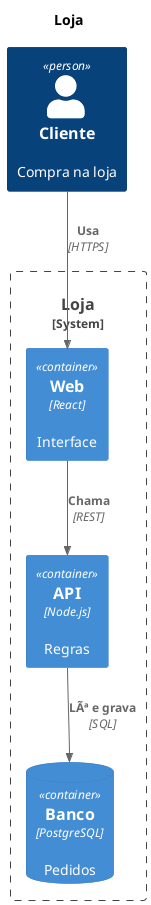

# Integração com o C4Arch

Como o C4Arch consome PlantUML: endpoints, templates, contrato do importador,
limitações e fluxo de UI/MCP. O exportador gera C4-PlantUML a partir do modelo
canônico; o importador faz o caminho inverso.

## Mapa do código

| Arquivo | Papel |
| --- | --- |
| `apps/api/src/c4/plantuml-import.ts` | Detecção e parser C4-PlantUML → `ImportedWorkspace` |
| `apps/api/src/c4/import-guards.ts` | Guardas contra importação parcial/destrutiva |
| `apps/api/src/c4/model-import.ts` | Persistência genérica (legado + canônico, views, autolayout, draw.io) |
| `apps/api/src/c4/plantuml-templates.ts` | `PLANTUML_TEMPLATES` (5 padrões prontos) |
| `apps/api/src/controllers/imports.controller.ts` | Validação, autorização, auditoria e endpoints |
| `apps/api/src/c4/exporters.ts` | `renderPlantUml` e metadados do formato `plantuml` |
| `apps/web/src/components/PlantUmlImportPanel.tsx` | Painel de importação (novo modelo ou modelo existente) |
| `apps/web/src/components/PlantUmlSourcePanel.tsx` | Editor de fonte PlantUML do modelo |
| `apps/web/src/services/collaboration.ts` | `listPlantUmlTemplates`, `importPlantUmlWorkspace`, `importPlantUmlIntoModel` |
| `apps/mcp/src/index.ts` | Ferramenta `c4_import_plantuml` |

## Endpoints

### `GET /api/models/import/plantuml/templates`

Retorna os padrões prontos:

```json
{
  "templates": [
    {
      "id": "containers",
      "name": "Sistema e containers",
      "description": "Aplicação web, API e banco de dados...",
      "c4Type": "container",
      "format": "plantuml",
      "content": "@startuml\n!include <C4/C4_Container>\n..."
    }
  ]
}
```

### `POST /api/models/import/plantuml`

Cria um modelo novo a partir do diagrama.

```json
{
  "orgId": "uuid",
  "content": "@startuml ... @enduml",
  "title": "Loja",
  "c4Type": "container",
  "folderId": "uuid|null",
  "parentId": "uuid|null",
  "format": "plantuml"
}
```

- `content` é obrigatório; limite de **5 MB**.
- `format` é opcional, mas só aceita `"plantuml"`.
- `c4Type` precisa ser um tipo C4 válido (`system-context`, `container`,
  `component`, `system-landscape`, `dynamic`, `deployment`, ...).
- Exige papel de escrita na organização.
- Cria o modelo como `draft`, importa em modo `replace`, regenera o DAS,
  grava auditoria (`model.import.plantuml`) e devolve `201` com o modelo e
  `import` (contagens).
- `folderId` e `parentId` são validados contra a organização.
- O template oficial `blank` é aceito: uma criação nova pode começar sem
  elementos.
- Relações que o parser não interpretou cancelam a importação com `400`
  antes de criar o modelo; um resultado parcial nunca é persistido.

### `POST /api/models/{id}/import/plantuml`

Importa/substitui o conteúdo de um modelo existente.

```json
{
  "content": "@startuml ... @enduml",
  "mode": "replace",
  "title": "Loja",
  "c4Type": "container"
}
```

- `mode`: `replace` (padrão) ou `merge`.
- `replace` substitui elementos e relações do modelo. Views existentes são
  preservadas (a view do import é atualizada por upsert), e elementos com o
  mesmo `identifier` mantêm o id canônico — com isso o layout manual das views
  preservadas e os vínculos com apps/serviços continuam válidos. Elementos que
  saíram do diagrama são removidos.
- `merge` casa elementos por `identifier` e atualiza os existentes; relações
  são recriadas.
- Exige permissão de escrita no modelo.
- Uma relação não interpretada ou um `replace` sem elementos em um modelo
  existente responde `400` e não altera o modelo.
- Resposta: `{ "ok": true, "das_content": "...", "import": { ... }, "model": { "elements": [...], "edges": [...] } }`.
  O snapshot é o conteúdo recém-persistido e deve ser usado para sincronizar o
  canvas, sem depender de uma releitura concorrente.

### Exportação

`GET /api/models/{id}/export/plantuml` gera `.puml` (`text/plain`). O formato
também aparece em `GET /api/models/{id}/exports`.

### Pré-visualização

`POST /api/plantuml/render` renderiza um diagrama PlantUML em SVG, usado pela
pré-visualização do painel de código. Recebe `{ "content": "..." }` (até ~100 kB,
limitado pelo parser de JSON da API) e retorna `image/svg+xml`. Requer
autenticação e responde `502` quando o servidor PlantUML falha ou demora mais de
15 s.

Em Docker, o serviço `plantuml` (porta 8080 interna) é usado; fora do Docker,
configure `PLANTUML_RENDER_URL_TEMPLATE` (padrão: servidor público do PlantUML).
O valor precisa conter o marcador `{encoded}`.

Antes de codificar, a API chama `ensureC4Include`: se o texto usa macros C4
(`Person`, `System`, `Container`, `Component`, `Rel`, boundaries) sem declarar
`!include`, a diretiva do nível adequado é injetada. Assim a pré-visualização
sempre desenha os ícones oficiais do C4 model, mesmo quando o código colado veio
sem o include.

## Templates prontos

| `id` | Nome | `c4Type` | Conteúdo |
| --- | --- | --- | --- |
| `system-context` | Contexto do sistema | `system-context` | pessoas, sistema, sistemas externos |
| `containers` | Sistema e containers | `container` | web, API, banco |
| `microservices` | Microserviços | `container` | gateway, serviços, fila, banco |
| `components` | Containers e componentes | `component` | componentes dentro de web e API |
| `blank` | Modelo em branco | `container` | só `@startuml` + include |

Todos usam `!include <C4/C4_...>` e são aceitos pelo parser.

## Contrato do importador

### Detecção

`detectPlantUmlFormat(content)` retorna `true` quando o texto contém
`@startuml` **ou** um `!include` que mencione `c4` (case-insensitive). Sem isso,
a importação responde `400 Diagrama PlantUML inválido`.

### Leitura

O parser percorre as declarações lógicas do diagrama:

1. Remove comentários de linha (`'`, `//`) e de bloco (`/' ... '/`) sem
   alterar textos entre aspas; junta macros divididas em várias linhas.
2. Reconhece `title`/`caption` com texto simples ou entre aspas (inclusive
   `title("...")`) e usa o último valor de cada diretiva. O texto direto pode
   conter apóstrofos sem ser truncado como comentário.
3. Reconhece macros C4 no formato `Macro(arg1, arg2, ...)` e declarações
   genéricas como `actor "Usuário" as user`, `actor user as "Usuário"` ou
   `database "Banco" as db`.
4. Elementos suportados (nomes case-insensitive):

| Macros | `kind` canônico |
| --- | --- |
| `Person`, `Person_Ext`, `Actor` | `person` |
| `System`, `System_Ext`, `SystemDb`, `SystemQueue` | `software_system` |
| `Container`, `Container_Ext`, `ContainerDb`, `ContainerQueue` | `container` |
| `Component`, `Component_Ext`, `ComponentDb`, `ComponentQueue` | `component` |
| `Deployment_Node`, `Node` | `deployment_node` |
| `Rectangle` | `software_system` |
| `Database`, `Queue` | `container` |
| `Interface`, `UseCase`, `Artifact` | `component` |

Fronteiras (`System_Boundary`, `Container_Boundary`, `Enterprise_Boundary` e
`Boundary`) não existem como tipo no C4Arch: viram o elemento estrutural do seu
nível (`software_system`, `container` ou `component`) para preservar a
hierarquia. Por isso elas aparecem na exportação como `System(...)`,
`Container(...)` ou `Component(...)` com bloco.

5. Relações: macros `Rel*`/`BiRel` e setas genéricas como `-->`, `..>`, `<--`,
   `<|--`, `*--`, `--*`, `<|..`, `..|>`, `-[#red]->` e `-right->`. A direção
   das setas reversas é preservada; `Rel_Back*` inverte a direção e `BiRel*`
   cria uma relação em cada sentido. Uma linha que pareça uma relação, mas não
   possa ser interpretada, é registrada em `unrecognizedRelationships` e a API
   recusa a importação para evitar um `replace` parcial.

Argumentos:

- `splitArgs` respeita aspas e parênteses aninhados.
- Macros aceitam posição (`alias`, `label`, ...) ou nomes (`$alias`, `$label`,
  `$descr`, `$technology`, `$tags`).
- 1º argumento é o **alias**; aliases repetidos são ignorados. Em declarações
  genéricas, tanto `actor "Label" as alias` quanto `actor alias as "Label"`
  mantêm o alias estável e o label.
- `Person`/`System`: 2º = nome, 3º = descrição.
- `Container`/`Component`: 2º = nome, 3º = **tecnologia**, 4º = descrição.
- `Rel`: 1º origem, 2º destino, 3º rótulo, 4º tecnologia.
- `$tags` (separadas por `+`, `,` ou `;`) viram `tags` canônicas.
- `parentIdentifier` é o elemento do bloco/boundary que contém a declaração.
- `$sprite`, `$link`, `$url` e propriedades arbitrárias continuam ignorados.

### Views

Uma única view, com chave `default`. O tipo é inferido do texto:

| Sinal no conteúdo | Tipo da view |
| --- | --- |
| `C4_Component` | `component` |
| `C4_Container` | `container` |
| `C4_Dynamic` | `dynamic` |
| `C4_Deployment` | `deployment` |
| nenhum | `system_context` |

### Persistência

`importWorkspaceIntoModel` grava:

- `elements`/`edges` (legado, usado pelo canvas);
- `model_elements`/`model_relationships`/`model_views` (canônico);
- `model_view_layout` e posições com autolayout (`LR`, `gapX=90`,
  `gapY=32`). Em `replace`, só as views do import são reposicionadas; views
  preservadas mantêm o layout manual;
- `model_state` sincronizado com o grafo aplicado (Yjs durável). A revisão do
  estado é usada como token CAS: o Realtime envia `expectedRevision`, a API
  responde `409` em divergência e o Realtime recarrega o estado durável. Um
  advisory lock PostgreSQL por `model_id` serializa importações concorrentes até
  a conclusão dessa sincronização;
- XML draw.io inicial no padrão C4 (shapes oficiais do draw.io, rótulos com
  placeholders `%c4Name%`/`%c4Type%`/`%c4Technology%`/`%c4Description%` e
  boundaries pontilhadas para a hierarquia);
- título, descrição (`caption`) e `c4_type` quando informados. O `title` do
  PlantUML atualiza o título do modelo quando a requisição não envia um título
  explícito; o `caption` atualiza a descrição persistida.

Em `replace`, elementos com o mesmo `identifier` reaproveitam o id canônico,
preservando `model_view_layout`, vínculos com apps/serviços e referências. O que
não aparece no diagrama é removido depois do upsert. Views que não vieram do
import não são apagadas.

Relações cujo destino/origem não foi importado (ou self-loop) são contadas em
`skippedRelationships`.

## Limitações do parser

- **Sem tipo próprio para boundaries.** Fronteiras viram o elemento estrutural
  do nível; a exportação PlantUML mostra uma caixa a mais em relação ao
  `*_Boundary` original e o desenho draw.io as representa como boundaries
  pontilhadas ao redor dos filhos.
- **Sprites, links e propriedades não são lidos.** `$sprite`, `$link`, `$url`,
  `AddElementTag` e propriedades arbitrárias são ignorados; `$tags` na própria
  declaração é suportado.
- **`RelIndex` e `BiRel_D` não são suportados.** `RelIndex` e variantes
  `BiRel_*` diferentes de `BiRel` podem ser rejeitados como relações não
  interpretadas; a importação não persiste um resultado parcial.
- **Índices de relação são ignorados.** `$index` não é confundido com a
  tecnologia da relação.
- **Tecnologia só em container/componente.** Em `Person`/`System`, o 3º
  argumento é descrição.
- **Sem atualização incremental de relações no `merge`.** Elementos são
  casados por identificador; relações são recriadas.
- **Um único `title` e um único `caption`.** O último valor de cada diretiva
  vence; a exportação os coloca entre aspas para preservar apóstrofos.
- **Sem validação semântica de C4.** O parser não impede, por exemplo,
  componente ligado a pessoa.

## Checklist para diagrama importável

- [ ] Bloco começa com `@startuml` e termina com `@enduml`.
- [ ] `!include <C4/C4_...>` é recomendado para macros C4, mas não é
      obrigatório em diagramas genéricos.
- [ ] Aliases sem espaços, hífens ou acentos.
- [ ] `Container`/`Component` com tecnologia no 3º argumento.
- [ ] Relações com verbo e, quando fizer sentido, tecnologia no 4º; setas
      genéricas devem estar entre as formas suportadas.
- [ ] `$tags` opcional, separadas por `+` (`$tags="externo+critico"`).
- [ ] Sem `$index`, `RelIndex` ou `BiRel_D`.
- [ ] `title` opcional, mas consistente com o nome do modelo.

Exemplo mínimo importável:



Resultado: 5 elementos (a fronteira `loja` vira um `software_system` pai de
`web`, `api` e `banco`), 3 relações e 1 view `container`.

## Exportação (`renderPlantUml`)

- Escolhe o include pelo maior nível presente: `C4_Component.puml` se houver
  componente, senão `C4_Container.puml` se houver container, senão
  `C4_Context.puml`.
- Emite `Person`, `System`, `Container` ou `Component` usando o `identifier`
  canônico como alias; sem identificador, cai em `e0`, `e1`, ... Aliases são
  sanitizados (sem espaços/acentos) e desambiguados quando colidem.
- Reproduz a hierarquia com boundaries oficiais: `System_Boundary`,
  `Container_Boundary` e `Boundary(alias, label, "Component")` para os
  elementos que têm filhos (`parent_element_id`). O elemento estrutural aparece
  como fronteira, não como caixa sólida, igual ao desenho draw.io.
- Reemite `$tags`, tecnologia de elemento e tecnologia da relação.
- Inclui `title` e `caption` entre aspas, com escapes para preservar apóstrofos
  e aspas no round-trip.
- Usa `!include <C4/C4_...>`; a biblioteca C4 é empacotada no servidor
  PlantUML e funciona sem acesso externo.

## UI

- **`PlantUmlImportPanel`**: cria modelo novo ou importa em modelo existente.
  Aceita colar conteúdo, escolher template, carregar `.puml`/`.plantuml`/
  `.txt`, definir título, `c4Type` e modo (`replace`/`merge`). Mostra erros da
  API e as contagens do resultado.
- **PlantUmlSourcePanel**: carrega o modelo exportado como `plantuml`,
  permite editar e aplica com `mode: 'replace'`; avisa sobre alterações não
  aplicadas.

- **`DrawioController.import`** agora chama `syncModelFromDrawio`: elementos e
  relações do XML salvo são sincronizados (upsert) no modelo, o DAS é
  regenerado e o estado colaborativo é invalidado. Componentes inseridos no
  draw.io aparecem automaticamente no código PlantUML.
- O canvas é sincronizado pela operação realtime `replaceModel` após a
  importação; a API também atualiza o `model_state` durável com o snapshot
  persistido e devolve esse snapshot na resposta. Uma falha na releitura dos
  metadados não cancela a propagação do snapshot, e uma conexão realtime que
  não confirma a atualização é reportada à interface. O Realtime usa
  `expectedRevision`; em `409`, recarrega o estado durável em vez de persistir
  o snapshot local antigo. O projetor preserva `identifier`, `url`, `tags`,
  hierarquia e tecnologia das relações, que o Yjs não transporta, e ignora
  flush com hash desatualizado.

## MCP

Ferramenta `c4_import_plantuml`:

```json
{
  "orgId": "uuid",
  "content": "@startuml ... @enduml",
  "title": "Loja",
  "c4Type": "container",
  "folderId": "uuid",
  "parentId": "uuid"
}
```

Cria um modelo novo (não importa em modelo existente). Para exportar, use a
ferramenta de exportação com `format: "plantuml"`.

## Diagnóstico

| Sintoma | Causa provável |
| --- | --- |
| `400 Diagrama PlantUML inválido` | falta `@startuml`/`!include` com `c4` |
| `400 Nenhum elemento C4 foi reconhecido` | o texto não contém declaração de elemento compatível ou o `replace` seria destrutivo |
| Elemento sumiu | macro não suportada, alias repetido ou referência que não corresponde a um elemento |
| Tecnologia no lugar errado | 3º argumento de `Person`/`System` é descrição |
| Relação não importada | origem/destino não existe, self-loop ou `BiRel_D` |
| Estrutura achatada | o fonte não usa blocos `{ ... }` (fronteiras e aninhamento são preservados) |
| `413` | conteúdo acima de 5 MB |
| `403` | usuário sem papel de escrita |
| `404` | `folderId`/`parentId`/modelo fora da organização |

## Testes

- `apps/api/test/plantuml-import.test.ts` cobre detecção, elementos,
  tecnologia, relações, `$tags`, boundaries/aninhamento, comentários, aliases
  repetidos e templates.
- `apps/api/test/exporters.test.ts` cobre a escolha do include, aliases
  canônicos, hierarquia, tags, tecnologia das relações e round-trip
  exportar → importar.
- `apps/api/test/projector.test.ts` cobre a preservação de detalhes canônicos
  (`identifier`, `url`, `tags`, pai e tecnologia) durante a projeção do Yjs.
- `apps/web/test/components.test.tsx` cobre o painel de importação.
- `apps/web/e2e/app.spec.ts` cobre o fluxo de UI.
