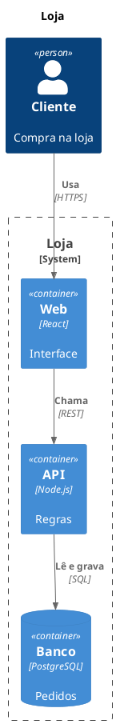

# Integração com o C4Arch

Como o C4Arch consome PlantUML: endpoints, templates, contrato do importador,
limitações e fluxo de UI/MCP. O exportador gera C4-PlantUML a partir do modelo
canônico; o importador faz o caminho inverso.

## Mapa do código

| Arquivo | Papel |
| --- | --- |
| `apps/api/src/c4/plantuml-import.ts` | Detecção e parser C4-PlantUML → `ImportedWorkspace` |
| `apps/api/src/c4/model-import.ts` | Persistência genérica (legado + canônico, views, autolayout, draw.io) |
| `apps/api/src/c4/plantuml-templates.ts` | `PLANTUML_TEMPLATES` (5 padrões prontos) |
| `apps/api/src/controllers/imports.controller.ts` | Validação, autorização, auditoria e endpoints |
| `apps/api/src/c4/exporters.ts` | `renderPlantUml` e metadados do formato `plantuml` |
| `apps/web/src/components/PlantUmlImportPanel.tsx` | Painel de importação (novo modelo ou modelo existente) |
| `apps/web/src/components/PlantUmlSourcePanel.tsx` | Editor de fonte PlantUML do modelo |
| `apps/web/src/services/collaboration.ts` | `listPlantUmlTemplates`, `importPlantUmlWorkspace`, `importPlantUmlIntoModel` |
| `apps/mcp/src/index.ts` | Ferramenta `c4_import_plantuml` |

## Endpoints

### `GET /api/models/import/plantuml/templates`

Retorna os padrões prontos:

```json
{
  "templates": [
    {
      "id": "containers",
      "name": "Sistema e containers",
      "description": "Aplicação web, API e banco de dados...",
      "c4Type": "container",
      "format": "plantuml",
      "content": "@startuml\n!include <C4/C4_Container>\n..."
    }
  ]
}
```

### `POST /api/models/import/plantuml`

Cria um modelo novo a partir do diagrama.

```json
{
  "orgId": "uuid",
  "content": "@startuml ... @enduml",
  "title": "Loja",
  "c4Type": "container",
  "folderId": "uuid|null",
  "parentId": "uuid|null",
  "format": "plantuml"
}
```

- `content` é obrigatório; limite de **5 MB**.
- `format` é opcional, mas só aceita `"plantuml"`.
- `c4Type` precisa ser um tipo C4 válido (`system-context`, `container`,
  `component`, `system-landscape`, `dynamic`, `deployment`, ...).
- Exige papel de escrita na organização.
- Cria o modelo como `draft`, importa em modo `replace`, regenera o DAS,
  grava auditoria (`model.import.plantuml`) e devolve `201` com o modelo e
  `import` (contagens).
- `folderId` e `parentId` são validados contra a organização.

### `POST /api/models/{id}/import/plantuml`

Importa/substitui o conteúdo de um modelo existente.

```json
{
  "content": "@startuml ... @enduml",
  "mode": "replace",
  "title": "Loja",
  "c4Type": "container"
}
```

- `mode`: `replace` (padrão) ou `merge`.
- `replace` apaga elementos/relações/views anteriores do modelo.
- `merge` casa elementos por `identifier` e atualiza os existentes; relações
  são recriadas.
- Exige permissão de escrita no modelo.
- Resposta: `{ "ok": true, "das_content": "...", "import": { ... } }`.

### Exportação

`GET /api/models/{id}/export/plantuml` gera `.puml` (`text/plain`). O formato
também aparece em `GET /api/models/{id}/exports`.

### Pré-visualização\n\n`POST /api/plantuml/render` renderiza um diagrama PlantUML em SVG, usado pela\npré-visualização do painel de código. Recebe `{ \"content\": \"...\" }` e retorna\n`image/svg+xml`. Requer autenticação. Em Docker, o serviço `plantuml` (porta\n8080 interna) é usado; fora do Docker, configure\n`PLANTUML_RENDER_URL_TEMPLATE` (padrão: servidor público do PlantUML).\n\n## Templates prontos

| `id` | Nome | `c4Type` | Conteúdo |
| --- | --- | --- | --- |
| `system-context` | Contexto do sistema | `system-context` | pessoas, sistema, sistemas externos |
| `containers` | Sistema e containers | `container` | web, API, banco |
| `microservices` | Microserviços | `container` | gateway, serviços, fila, banco |
| `components` | Containers e componentes | `component` | componentes dentro de web e API |
| `blank` | Modelo em branco | `container` | só `@startuml` + include |

Todos usam `!include <C4/C4_...>` e são aceitos pelo parser.

## Contrato do importador

### Detecção

`detectPlantUmlFormat(content)` retorna `true` quando o texto contém
`@startuml` **ou** um `!include` que mencione `c4` (case-insensitive). Sem isso,
a importação responde `400 Diagrama PlantUML inválido`.

### Leitura

O parser percorre linha a linha:

1. Remove espaços nas pontas; ignora vazias, comentários (`'`) e linhas que
   começam com `@` ou `!`.
2. Reconhece `title "..."` ou `title("...")` e usa o último como nome.
3. Reconhece **uma macro por linha** no formato
   `Macro(arg1, arg2, ...)` com `{` opcional no fim.
4. Elementos suportados (nomes case-insensitive):

| Macros | `kind` canônico |
| --- | --- |
| `Person`, `Person_Ext` | `person` |
| `System`, `System_Ext`, `SystemDb`, `SystemQueue` | `software_system` |
| `Container`, `Container_Ext`, `ContainerDb`, `ContainerQueue` | `container` |
| `Component`, `Component_Ext`, `ComponentDb`, `ComponentQueue` | `component` |

5. Relações: qualquer macro cujo nome em minúsculas comece com `rel`
   (`Rel`, `Rel_Back`, `Rel_D`, `Rel_R`, ...), além de `BiRel` e `Rel_Back`.

Argumentos:

- `splitArgs` respeita aspas e parênteses aninhados.
- 1º argumento é o **alias**; aliases repetidos são ignorados.
- `Person`/`System`: 2º = nome, 3º = descrição.
- `Container`/`Component`: 2º = nome, 3º = **tecnologia**, 4º = descrição.
- `Rel`: 1º origem, 2º destino, 3º rótulo, 4º tecnologia.
- `tags`, `url` e `parentIdentifier` ficam vazios.

### Views

Uma única view, com chave `default`. O tipo é inferido do texto:

| Sinal no conteúdo | Tipo da view |
| --- | --- |
| `C4_Component` | `component` |
| `C4_Container` | `container` |
| `C4_Dynamic` | `dynamic` |
| `C4_Deployment` | `deployment` |
| nenhum | `system_context` |

### Persistência

`importWorkspaceIntoModel` grava:

- `elements`/`edges` (legado, usado pelo canvas);
- `model_elements`/`model_relationships`/`model_views` (canônico);
- `model_view_layout` e posições com autolayout (`LR`, `gapX=90`,
  `gapY=32`);
- XML draw.io inicial;
- título e `c4_type` quando informados.

Relações cujo destino/origem não foi importado (ou self-loop) são contadas em
`skippedRelationships`.

## Limitações do parser

- **Sem hierarquia de boundaries.** `System_Boundary`, `Container_Boundary`,
  `Enterprise_Boundary` e `Boundary` são ignoradas; os elementos internos são
  importados sem pai.
- **Sem tags, sprites, links ou propriedades.** `$tags`, `$sprite`, `$link` e
  `AddElementTag` não são lidos.
- **Uma macro por linha.** Argumentos multilinha, macros quebradas ou
  construções como `rectangle "X" as y { ... }` não são reconhecidas.
- **Comentário no fim da linha quebra o parser.** O regex exige que a linha
  termine em `)` ou `) {`.
- **`RelIndex` e `BiRel_D` não são suportados corretamente.** `RelIndex` cai em
  `startsWith('rel')` e tem os argumentos deslocados; `BiRel_*` diferentes de
  `BiRel` são ignorados.
- **`$index` vira tecnologia.** Em `Rel(a, b, "x", $index=1)`, o 4º argumento é
  lido como tecnologia. Evite em conteúdo importável.
- **Tecnologia só em container/componente.** Em `Person`/`System`, o 3º
  argumento é descrição.
- **Sem atualização incremental de relações no `merge`.** Elementos são
  casados por identificador; relações são recriadas.
- **Um único `title`.** O último vence.
- **Sem validação semântica de C4.** O parser não impede, por exemplo,
  componente ligado a pessoa.

## Checklist para diagrama importável

- [ ] Bloco começa com `@startuml` e termina com `@enduml`.
- [ ] `!include <C4/C4_...>` presente (ajuda na detecção e no render).
- [ ] Uma macro por linha, sem comentário no fim.
- [ ] Aliases sem espaços, hífens ou acentos.
- [ ] `Container`/`Component` com tecnologia no 3º argumento.
- [ ] Relações com verbo e, quando fizer sentido, tecnologia no 4º.
- [ ] Sem `$index`, `RelIndex`, `BiRel_D` ou tags.
- [ ] `title` opcional, mas consistente com o nome do modelo.

Exemplo mínimo importável:



Resultado: 4 elementos, 3 relações, 1 view `container`; `System_Boundary`
ignorada.

## Exportação (`renderPlantUml`)

- Escolhe o include pelo maior nível presente: `C4_Component.puml` se houver
  componente, senão `C4_Container.puml` se houver container, senão
  `C4_Context.puml`.
- Emite `Person`, `System`, `Container` ou `Component` com aliases `e0`, `e1`,
  ...
- Emite `Rel` com rótulo e tecnologia quando existirem.
- Inclui `title` e `caption`.
- Usa a URL remota `raw.githubusercontent.com/.../master/...` — renderização
  offline precisa de include local.

## UI

- **`PlantUmlImportPanel`**: cria modelo novo ou importa em modelo existente.
  Aceita colar conteúdo, escolher template, carregar `.puml`/`.plantuml`/
  `.txt`, definir título, `c4Type` e modo (`replace`/`merge`). Mostra erros da
  API e as contagens do resultado.
- **`PlantUmlSourcePanel`**: carrega o modelo exportado como `plantuml`,
  permite editar e aplica com `mode: 'replace'`; avisa sobre alterações não
  aplicadas.
- O canvas é sincronizado pela operação realtime `replaceModel` após a
  importação.

## MCP

Ferramenta `c4_import_plantuml`:

```json
{
  "orgId": "uuid",
  "content": "@startuml ... @enduml",
  "title": "Loja",
  "c4Type": "container",
  "folderId": "uuid",
  "parentId": "uuid"
}
```

Cria um modelo novo (não importa em modelo existente). Para exportar, use a
ferramenta de exportação com `format: "plantuml"`.

## Diagnóstico

| Sintoma | Causa provável |
| --- | --- |
| `400 Diagrama PlantUML inválido` | falta `@startuml`/`!include` com `c4` ou nenhuma macro reconhecida |
| Elemento sumiu | macro não suportada, alias repetido ou linha com comentário no fim |
| Tecnologia no lugar errado | 3º argumento de `Person`/`System` é descrição |
| Relação não importada | origem/destino não existe, self-loop ou `BiRel_D` |
| Estrutura achatada | boundaries não são importadas |
| `413` | conteúdo acima de 5 MB |
| `403` | usuário sem papel de escrita |
| `404` | `folderId`/`parentId`/modelo fora da organização |

## Testes

- `apps/api/test/plantuml-import.test.ts` cobre detecção, elementos,
  tecnologia, relações, comentários, aliases repetidos e templates.
- `apps/api/test/exporters.test.ts` cobre a escolha do include e a saída
  PlantUML.
- `apps/web/test/components.test.tsx` cobre o painel de importação.
- `apps/web/e2e/app.spec.ts` cobre o fluxo de UI.
