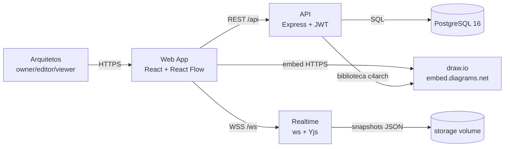
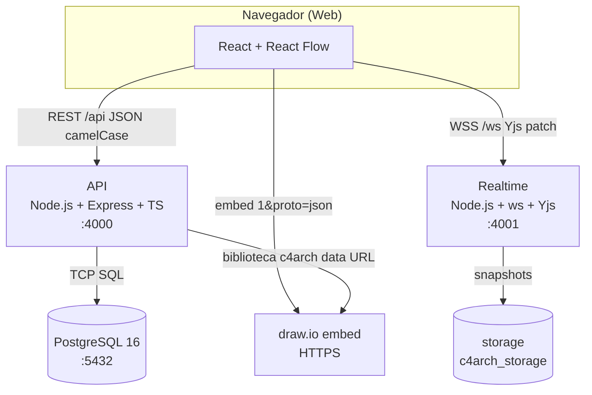

# Documento de Arquitetura de Soluções (DAS) — C4Arch

> **Versão:** 1.2.0
> **Status:** Aprovado (MVP em estabilização)
> **Licença:** MIT
> **Baseado em:** `docs/DAS-template.md`, `docs/PRD.md`, `docs/PDR.md`, `docs/SECURITY.md`, `docs/ADR/`
> **Data:** 06/11/2026

---

## 1. Informações do documento

| Campo | Valor |
|---|---|
| Projeto | C4Arch — Arquitetura C4 colaborativa e viva |
| Versão | 0.4.0 |
| Data | 06/11/2026 |
| Autor(es) | Time C4Arch |
| Revisores | Arquiteto Sênior |
| Aprovador | Arquiteto Sênior |
| Status | MVP em estabilização |
| Referências | `docs/PRD.md`, `docs/SECURITY.md`, `docs/ADR/`, modelo C4 |

---

## 2. Visão geral

### 2.1 Propósito

C4Arch é uma ferramenta aberta (MIT) que permite a arquitetos de soluções
desenhar **um modelo único e vivo de C4 completo** (Actor, System, Container e
Component), com suas conexões, em colaboração em tempo real, com persistência
no PostgreSQL e edição simultânea via CRDT (Yjs). O produto nasce para equipes
pequenas (4 arquitetos no MVP) que hoje mantêm arquitetura em planilhas,
apresentações e diagramas desatualizados, e que precisam de uma fonte única,
consultável e versionada.

### 2.2 Escopo

- **Incluído:** autenticação JWT, organizações e membership, CRUD de modelos
  C4 tipados (`c4_type`/`c4_scope`), editor visual (React Flow 12), edição
  concorrente sem perda de campos, acesso ao editor draw.io (embed oficial) com
  biblioteca de shapes `c4arch`, importação/exportação de XML draw.io,
  persistência de snapshots JSON, gestão de pastas, apps e serviços reutilizáveis
  com propagação de edições e dependências, perfis/grupos de acesso
  (owner/editor/viewer), multi-diagrama no mesmo modelo (`models.diagrams`
  JSONB), navegação por abas e evolução contexto → container → componente →
  código, pastas em árvore com filtro por nome, persistência da tela no F5,
  importação em lote de modelos (arquivo/pasta local, Google Drive e outras
  URLs) e geração automática de DAS a partir de todos os tipos de diagrama.
- **Excluído (fora do MVP):** comentários, histórico de versões/restauração,
  exportação JSON/YAML (model-as-code), sincronização com Google Drive/GitLab
  (ADR-0002 rejeitada no MVP), permissões granulares aplicadas em todas as
  rotas/UI, hierarquia C4 genérica em múltiplos níveis e escala horizontal do
  realtime.
- **Fronteiras:** PostgreSQL 16 (fonte de verdade), serviço realtime (ws + Yjs)
  com snapshots em volume `storage`, editor draw.io hospedado em
  `embed.diagrams.net` (HTTPS), biblioteca de shapes servida como data URL.

### 2.3 Glossário

| Termo | Definição |
|---|---|
| C4 Model | Modelo de abstração em 4 níveis: Contexto, Container, Componente, Código. |
| CRDT (Yjs) | Estrutura de dados replicada livre de conflitos usada para edição colaborativa. |
| Modelo C4 | Entidade principal do C4Arch: título, descrição, status, pasta, tipo/escopo C4. |
| Elemento | Nó do diagrama (actor/system/container/component) ou shape do draw.io. |
| Conexão (edge) | Relação entre dois elementos (call, async, etc.). |
| App / Serviço | Objeto reutilizável do catálogo, propagado para todos os modelos que o usam. |
| DAS | Documento de Arquitetura de Soluções gerado a partir do modelo. |
| draw.io | Editor de diagramas embarcado (HTTPS) com biblioteca `c4arch`. |

---

## 3. Requisitos e restrições

### 3.1 Requisitos funcionais (resumo)

Referência: `docs/PRD.md` (RF-01 a RF-24). Destaques entregues: login/sessão
persistente (RF-01), organização e membership (RF-02), CRUD de modelo com
título/descrição/status/pasta (RF-03), busca/filtro de pastas por nome (RF-04),
editor C4 com nós e conexões (RF-05), edição concorrente sem perda de campos
(RF-06), acesso ao draw.io ao criar/editar (RF-07), importação/exportação
draw.io XML (RF-08), pastas/apps/serviços (RF-09), modelos tipados por diagrama
C4 (RF-15), apps/serviços reutilizáveis com propagação e dependências (RF-16),
biblioteca draw.io `c4arch` com download (RF-17), perfis e grupos de acesso
(RF-18), multi-diagrama no mesmo modelo (RF-19), navegação/evolução entre tipos
(RF-20), restauração da tela no F5 (RF-21), hierarquia de pastas em árvore
(RF-22), importação de modelos por arquivo/pasta/Drive/URL (RF-23) e DAS
automático para todos os tipos de diagrama (RF-24).

### 3.2 Requisitos não funcionais

| Categoria | Requisito | Métrica/Alvo |
|---|---|---|
| Desempenho | Modelo com 4 níveis + conexões fluido para 4 editores | p95 interação < 100 ms |
| Disponibilidade | Restart policy + healthchecks em todos os serviços | 99% em dev |
| Escalabilidade | 4 editores simultâneos por modelo | CRDT em memória |
| Segurança | JWT HS256, RBAC, tokens escopados draw.io 5 min | Ver `docs/SECURITY.md` |
| Portabilidade | Node.js 20 LTS, PostgreSQL 16, Docker Compose | Containers não-root |
| Observabilidade | `/healthz` verifica Postgres; logs estruturados | Healthcheck por serviço |
| Manutenibilidade | Typecheck real (`tsc --noEmit`) no build do frontend | 0 erros de tipo |

### 3.3 Restrições

- **Técnicas:** Node.js 20 LTS; PostgreSQL 16; React + TypeScript + Vite; React
  Flow 12; Yjs + WebSocket; Docker Compose.
- **Organizacionais:** equipe de 4 arquitetos no MVP; licença MIT.
- **Regulatórias:** LGPD (dados de usuários/organizações); segredos via
  variáveis de ambiente; containers não-root, `cap_drop: ALL`, filesystem
  read-only em produção.

### 3.4 Premissas

- O navegador tem acesso HTTPS ao `embed.diagrams.net`.
- O PostgreSQL é a fonte de verdade; o realtime mantém estado em memória com
  snapshots em disco (risco conhecido de duas fontes).
- A biblioteca `c4arch` é gerada dinamicamente a partir de `apps`/`services`.

---

## 4. Stakeholders e personas

| Stakeholder | Papel | Interesse principal |
|---|---|---|
| Arquiteto Sênior | owner | Aprovar modelos, organizar workspace, exportar |
| Arquiteto de Soluções | editor | Construir sistemas, contêineres e conexões |
| Arquiteto de Engenharia | editor | Detalhar componentes, integrar com código |
| Arquiteto de Negócio | viewer | Ler, comentar e validar o modelo |

---

## 5. Visão de contexto (C4 — Nível 1)

### 5.1 Diagrama de contexto (draw.io)

Abaixo, a imagem do desenho criado no draw.io (visão de contexto do C4Arch).
Exporte o diagrama do editor draw.io (Arquivo → Exportar como → PNG/SVG) e salve
como `docs/images/c4arch-context.png` para que a imagem abaixo seja exibida.

> **Visualização online do desenho:** abra o modelo no C4Arch e use
> "Abrir no draw.io"; ou visualize o XML exportado em
> [viewer.diagrams.net](https://viewer.diagrams.net/).

**Diagrama equivalente (Mermaid — visão de contexto):**

### 5.2 Descrição dos elementos (contexto)

| Elemento | Tipo | Descrição |
|---|---|---|
| Arquitetos | Person | Usuários (owner/editor/viewer) que colaboram no modelo C4. |
| Web App | Software System | Frontend React + React Flow; UI de edição e visualização. |
| API | Software System | Backend Node.js/Express; regras de negócio, REST, auth. |
| Realtime | Software System | Serviço WebSocket com CRDT Yjs para edição colaborativa. |
| PostgreSQL | Software System | Fonte de verdade (modelos, elementos, conexões, usuários, orgs). |
| storage | Software System | Volume com snapshots JSON do realtime. |
| draw.io | Software System | Editor de diagramas embarcado (HTTPS) com biblioteca `c4arch`. |

### 5.3 Interfaces externas

| Sistema externo | Protocolo | Contrato | SLA |
|---|---|---|---|
| PostgreSQL | TCP/5432 | SQL | 99.9% |
| draw.io (embed) | HTTPS | postMessage (proto=json) | depende do serviço |
| storage (volume) | filesystem | JSON atômico (.tmp + rename) | local |

---

## 6. Visão de containers (C4 — Nível 2)

### 6.1 Diagrama de containers (draw.io)

Imagem do desenho criado no draw.io (visão de containers). Exporte e salve como
`docs/images/c4arch-containers.png`.

**Diagrama equivalente (Mermaid — containers):**

### 6.2 Containers

| Container | Tecnologia | Responsabilidade | Porta/Endpoint |
|---|---|---|---|
| Web | React + Vite + React Flow + TypeScript | UI e editor visual C4 | 3000 |
| API | Node.js + Express + TypeScript | Regras de negócio, REST, auth, RBAC | 4000 |
| Realtime | Node.js + ws + Yjs | Edição colaborativa (CRDT) por modelo | 4001 |
| Worker | Node.js | Versões/sincronização (futuro) | — |
| DB | PostgreSQL 16 | Fonte de verdade | 5432 |
| storage-init | shell | Inicializa permissões do volume `storage` | — |

### 6.3 Comunicação entre containers

| Origem | Destino | Protocolo | Formato | Autenticação |
|---|---|---|---|---|
| Web | API | HTTPS/REST | JSON (camelCase) | JWT Bearer |
| Web | Realtime | WSS | Yjs patch | JWT (query) |
| Web | draw.io | HTTPS embed | postMessage | token escopado (5 min) |
| API | DB | TCP | SQL | credenciais env |
| Realtime | API | HTTP | JSON | token de serviço (opcional) |
| API → Web (biblioteca) | draw.io | data URL | XML `<mxlibrary>` | token escopado |

---

## 7. Visão de componentes (C4 — Nível 3)

### 7.1 Componentes por container

#### API (`apps/api`)

- Controllers: `AuthController`, `ModelController`, `ElementController`,
  `EdgeController`, `FolderController`, `AppController`, `ServiceController`,
  `DrawioController`, `GroupController`, `UserController`.
- Middlewares: `verifyToken`, `verifyDrawioAccess`.
- Acesso/RBAC: `auth/access.ts` (owner/editor/viewer + grupos).
- Geração de DAS: `c4/das.ts` (`generateDAS`, `regenerateModelDAS`,
  `regenerateAllDAS`, `parseDrawio`). O DAS consolida o diagrama primário e
  todos os tipos extras de `models.diagrams`.
- Assets draw.io: `c4/assets.ts` (marcadores `c4archAssetId/Kind/Name`).

#### Web (`apps/web`)

- `App.tsx` (orquestração), `Canvas.tsx` (React Flow).
- `UserManagement`, `GroupManagement`.
- `services/api.ts`, `services/ws.ts`, `services/types.ts`.

#### Realtime (`apps/realtime`)

- `sync.ts` (Yjs, merge parcial, snapshots atômicos, hidratação da API).

### 7.2 Diagrama de componentes (draw.io)

Imagem do desenho criado no draw.io (visão de componentes). Exporte e salve
como `docs/images/c4arch-components.png`.

---

## 8. Visão de código (C4 — Nível 4)

- **Pacotes:** monorepo npm workspaces (`apps/api`, `apps/web`, `apps/realtime`,
  `apps/worker`).
- **Padrões:** REST com normalização snake_case→camelCase; CRDT em memória;
  RBAC por organização; tokens escopados para draw.io.
- **Tipos:** fonte única em `apps/web/src/services/types.ts`; typecheck real no
  build (`tsc --noEmit`).

---

## 9. Modelo de dados

### 9.1 Entidades principais

| Entidade | Descrição | Chave |
|---|---|---|
| users | Usuários | id (UUID) |
| organizations | Organizações/workspaces | id (UUID) |
| memberships | Vínculo usuário-org com papel | (org_id, user_id) |
| models | Modelos C4; diagrama primário em `c4_type`/`drawio_xml` e tipos extras em `diagrams` (JSONB; `parent_id` legado) | id (UUID) |
| elements | Elementos C4 (actor/system/container/component) | id (UUID) |
| edges | Conexões entre elementos | id (UUID) |
| folders | Pastas (hierárquicas) | id (UUID) |
| apps / services | Objetos reutilizáveis C4 | id (UUID) |
| access_groups | Grupos de acesso | id (UUID) |
| access_group_members | Membros dos grupos | (group_id, user_id) |

### 9.2 Relacionamentos

- `organizations 1..n memberships n..1 users`
- `organizations 1..n models`, `models n..1 folders`
- `models 1..n elements`, `models 1..n edges`
- `models 1..n diagrams` (tipos extras do mesmo modelo em `models.diagrams`;
  o tipo primário continua em `models.c4_type`/`drawio_xml`)
- `models 1..n models` (self-reference legada via `parent_id`, mantida para
  compatibilidade; o índice único `(COALESCE(parent_id, id), c4_type)` impede
  repetir o tipo no grupo)
- `elements n..1 apps/services` (opcional)
- `folders 1..n folders` (self-reference via `parent_id`)

### 9.3 Persistência

- **PostgreSQL:** fonte de verdade (modelos, elementos, conexões, usuários,
  orgs, permissões, `drawio_xml`, `diagrams` JSONB e `das_content`).
- **Realtime/Yjs:** estado ativo de edição em memória por modelo.
- **Snapshots JSON:** cache/recuperação do realtime (volume `storage`).

### 9.4 DAS automático

O campo `models.das_content` é **derivado**, não uma fonte editável
independente. A API o regenera em:

- criação de modelo (`POST /api/models`);
- atualização de modelo (`PUT /api/models/:id`);
- adição de um tipo de diagrama (`POST /api/models/:id/diagrams`);
- importação de XML draw.io (`POST /api/models/:id/drawio/import`);
- importação de modelo por arquivo/Drive/URL (`POST /api/models/import`);
- primeira leitura de um modelo sem conteúdo (`GET /api/models/:id/das`);
- startup da API, via `regenerateAllDAS`, aplicando o formato atual a todos os
  modelos existentes.

A geração percorre o tipo primário (`c4_type`/`drawio_xml`) e os tipos extras
de `models.diagrams`. O parser entende objetos com metadados
(`<object>`/`<UserObject>`), células nativas (`<mxCell>`), páginas comprimidas
(base64 + deflate) e placeholders do template C4 (`%c4Name%`,
`%c4Description%`, `%c4Technology%`, `%c4Type%`), resolvendo as conexões para
os nomes dos elementos. Shapes com marcadores `c4archAssetId`/`c4archAssetKind`
são enriquecidos com nome, descrição e endpoint/tecnologia dos registros de
`apps`/`services`. O documento resultante contém informações do modelo,
inventário de diagramas com contagem de elementos/conexões, seções 5.2–5.5
para contexto/containers/componentes/código, seção para landscape, dinâmico e
implantação, além das tabelas agregadas de elementos e conexões (com origem,
destino, rótulo, tecnologia e diagramas de origem). A pré-visualização e o PDF
renderizam o mesmo Markdown (títulos, tabelas, listas, citação) e exibem o
desenho draw.io em um iframe.

O editor do DAS no app apresenta uma navegação por seções (cabeçalho + blocos
`##`), formulário central com Markdown e painel lateral de status/validações.
O salvamento é explícito (`Salvar DAS` ou `Ctrl+S`) e fechar/regenerar com
alterações pendentes pede confirmação. Como qualquer regeneração substitui o
conteúdo, o modelo C4 continua sendo a fonte de verdade. Detalhes de UX em
`docs/UX-DAS-EDITOR.md`.

---

## 10. Segurança

Autenticação JWT HS256 (`issuer: c4arch`), senhas com `scrypt` + salt,
autorização por organização em todas as rotas (RBAC owner/editor/viewer),
tokens escopados de 5 min para draw.io, Helmet, CORS com allowlist, rate limit,
WebSocket autenticado e autorizado por modelo, containers não-root com
`cap_drop: ALL`. A importação por URL (`POST /api/models/import`) baixa o
conteúdo no servidor com timeout de 15 s, limite de 5 MB por XML, validação de
XML e bloqueio de hosts internos/loopback (SSRF), inclusive após
redirecionamentos.
Links de pasta do Google Drive são rejeitados (exigiriam OAuth); apenas links
públicos de arquivo são aceitos. Detalhes, configuração e riscos residuais em
`docs/SECURITY.md`.

---

## 11. Decisões de arquitetura (ADRs)

Referência: `docs/ADR/`. Principais:

| ADR | Tema | Status |
|---|---|---|
| 0001 | Sincronização em tempo real com Yjs + WebSocket | Adotada |
| 0002 | Storage local JSON vs Drive/GitLab | Rejeitada (MVP) |
| 0003 | Docker + Compose | Adotada |
| 0004 | Licença MIT | Adotada |
| 0005 | Nome do projeto C4Arch | Adotada |
| 0006 | React Flow 12 | Adotada |
| 0007 | API autossuficiente | Adotada |
| 0008 | WebSocket cliente singleton + reconnect | Adotada |
| 0009 | API do modelo CRUD + pasta | Adotada |
| 0010 | Realtime merge parcial, IDs estáveis, snapshot atômico | Adotada |
| 0011 | Tipos frontend e typecheck no build | Adotada |
| 0012 | CRUD de modelo e acesso ao draw.io | Adotada |
| 0013 | Remoção de código morto | Adotada |
| 0014 | Hardening de segurança | Adotada |
| 0015 | Perfis e grupos de acesso | Adotada |
| 0016 | Biblioteca draw.io `c4arch` | Adotada |
| 0017 | Vínculo de novos tipos de diagrama a um modelo existente (`parent_id`, legado) | Substituída parcialmente pela 0018 |
| 0018 | Multi-diagrama no mesmo modelo (`models.diagrams`) e persistência da tela no F5 | Adotada |
| 0019 | Importação de modelos por arquivo/pasta/Drive/URL e geração automática de DAS | Adotada |

---

## 12. Infraestrutura e deploy

### 12.1 Topologia

Serviços: `db`, `api`, `web`, `realtime`, `worker`, `storage-init`.

### 12.2 Variáveis de ambiente

Ver `.env.example`. Principais: `JWT_SECRET`, `POSTGRES_*`, `CORS_ORIGIN`,
`BIND_ADDR`, `ALLOW_REGISTRATION`, `SEED_DEMO`.

### 12.3 Portas

| Serviço | Porta (dev) |
|---|---|
| web | 3000 |
| api | 4000 |
| realtime | 4001 |
| db | 5432 |

### 12.4 Volumes

- `pgdata`: dados do PostgreSQL.
- `c4arch_storage`: snapshots JSON.

---

## 13. Qualidade e testes

- Typecheck real no build do frontend (`tsc --noEmit`).
- `npm audit` sem vulnerabilidades.
- Testes manuais de API e WebSocket.
- SAST/DAST pendentes (Trivy, Semgrep, Gitleaks) para CI.

---

## 14. Roadmap e riscos

### 14.1 Roadmap

1. Estabilização (fonte de verdade única, autorização em todas as rotas).
2. Colaboração completa (comentários, presença, versões).
3. Interoperabilidade (exportação JSON/YAML, Drive/GitLab).
4. Escala (realtime com persistência robusta, múltiplas instâncias).

### 14.2 Riscos conhecidos

- Duas fontes de estado (Postgres e Yjs) — consolidação pendente.
- Rate limit em memória por réplica.
- Segredos em variáveis de ambiente.
- Estado do realtime em memória (sem reconciliação transacional).

---

## 15. Aprovação

| Papel | Nome | Data | Assinatura |
|---|---|---|---|
| Arquiteto Sênior | _ | _ | _ |
| Tech Lead | _ | _ | _ |
| Product Owner | _ | _ | _ |

---

## Histórico de versões

| Versão | Data | Autor | Descrição |
|---|---|---|---|
| 1.0.0 | 06/11/2026 | Time C4Arch | Versão inicial do DAS preenchida com base na documentação e no desenho draw.io |
| 1.1.0 | 06/11/2026 | Time C4Arch | Importação em lote (arquivo/pasta/Drive/URL), DAS automático para todos os tipos de diagrama e backfill de modelos antigos |
| 1.2.0 | 06/11/2026 | Time C4Arch | DAS coerente com os desenhos draw.io: parser de objetos/comprimidos/placeholders, enriquecimento por apps/serviços e formatação em tabelas na pré-visualização/PDF |

---

## Anexo A — Como inserir a imagem do draw.io

1. Abra o modelo no C4Arch e clique em **Abrir draw.io**.
2. No editor draw.io, edite o diagrama (use a biblioteca `c4arch` para apps/serviços).
3. Exporte: **Arquivo → Exportar como → PNG** (ou SVG).
4. Salve o arquivo em `docs/images/` com o nome correspondente à visão:
   - `c4arch-context.png` (visão de contexto)
   - `c4arch-containers.png` (visão de containers)
   - `c4arch-components.png` (visão de componentes)
5. O DAS (este documento) referencia essas imagens nas seções 5.1, 6.1 e 7.2.
6. O C4Arch também gera o DAS automaticamente a partir do modelo, incluindo a
   imagem do diagrama draw.io na visualização/PDF (ver `apps/api/src/c4/das.ts`
   e `apps/web/src/App.tsx`).
